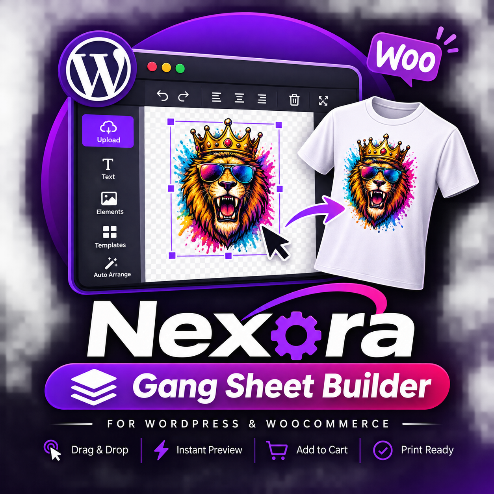

<p align="center">
  
</p>

# Nexora Gang Sheet Builder for WordPress & WooCommerce

[](https://wordpress.org)
[](https://woocommerce.com)
[](https://react.dev)
[](http://fabricjs.com)
[](https://developer.woocommerce.com)
[](LICENSE)

A production-grade, full-screen **Direct-to-Film (DTF) Gang Sheet Builder** WordPress plugin. Features an interactive transparent checkerboard canvas, drag-and-drop design positioning, automatic bin-packing nesting algorithms, real-time DPI resolution checker, 300 DPI print-ready export (PNG & PDF), and seamless two-way integration with WooCommerce Simple & Variable products.

---

## Key Highlights

- **Dark Professional Interface**: Inspired by industry-standard Gang Sheet apps with purple accent theme, responsive 3-column layout, zoom navigation, and multiple sheet support.
- **Interactive Fabric.js Canvas**: Smooth object drag, resize, rotate, align, flip, duplicate, delete, and layer ordering with lock/unlock controls.
- **Smart Dynamic Pricing**:
  - Automatically syncs prices directly from WooCommerce Simple and Variable products.
  - Dynamically calculates by Tiered Sq. Ft., Sq. In., or Fixed Preset dimensions when using custom sheets.
  - Multiplies line item quantity securely.
  - **Server-Side Security**: Recalculates and validates prices on the server to prevent client-side manipulation.
- **WooCommerce Product Page Integration**:
  - Direct "Build Your DTF Gang Sheet" button on single product pages.
  - Seamlessly detects and forwards the active selected variation (e.g. `22in x 12in`, `22in x 24in`, `22in x 36in`, `22in x 48in`) into the builder.
  - Auto-adjusts canvas dimensions and base price to match the chosen variation.
- **Bulletproof Cart & Checkout Flow**:
  - Saves canvas vector data and lightweight preview image.
  - Generates custom cart line items with preview thumbnails, dimensions, area, and edit links.
  - HPOS-compatible order line item metadata with admin download buttons for 300 DPI print-ready artwork.
- **High-Resolution Export Engine**:
  - Generates transparent 300 DPI print files up to large-scale rolls (22" × 240").
  - Print-ready PDF and high-res PNG export with physical dimensions preserved.
- **AI & Intelligent Tools**:
  - One-click auto-nesting packing algorithm to reduce wasted film and maximize profit.
  - AI transparent background removal simulation.

---

## Architecture Overview

```
nexora-gang-sheet-builder/
├── nexora-gang-sheet-builder.php    # Plugin entrypoint & HPOS declaration
├── readme.txt                       # WordPress plugin directory standard
├── admin/                           # 12-tab administrative settings panel
│   ├── css/nexora-admin.css
│   ├── js/nexora-admin.js
│   └── views/admin-main.php
├── assets/                          # Static branding & preview assets
├── frontend/                        # React 18 + Fabric.js SPA application
│   ├── src/
│   │   ├── App.jsx                  # Main Builder state machine
│   │   ├── main.jsx                 # Dynamic mount loader
│   │   ├── components/
│   │   │   ├── TopNav/              # Sheet switcher, cart counter
│   │   │   ├── LeftSidebar/         # Uploads, cloud import, media
│   │   │   ├── CenterCanvas/        # Fabric canvas, toolbars, zoom
│   │   │   ├── RightSidebar/        # Layers, presets, products, pricing
│   │   │   ├── BottomBar/           # Total price, qty, utilization, checkout
│   │   │   └── Modals/              # Export, preview, saved designs
│   │   ├── hooks/                   # useFabricCanvas hook
│   │   └── utils/                   # Packing algorithm, API client
│   ├── package.json
│   └── vite.config.js
├── includes/                        # Modular PHP Backend
│   ├── class-nexora-core.php        # Core hooks, asset registration, modal
│   ├── class-nexora-activator.php   # DB tables and default options
│   ├── class-nexora-deactivator.php # Cleanup and deactivation
│   ├── class-nexora-woocommerce.php # WC hooks, cart, checkout & HPOS order meta
│   ├── class-nexora-api.php         # REST API endpoints
│   ├── class-nexora-db.php          # Database abstraction layer
│   ├── class-nexora-export.php      # 300 DPI image processing
│   └── class-nexora-shortcodes.php  # Shortcodes ([nexora_gang_sheet_builder])
└── public/                          # Production Vite bundle (JS/CSS)
```

---

## Installation

1. Download the production archive [`nexora-gang-sheet-builder.zip`](nexora-gang-sheet-builder.zip).
2. In your WordPress admin, navigate to **Plugins > Add New > Upload Plugin**.
3. Choose `nexora-gang-sheet-builder.zip` and click **Install Now**.
4. Activate the plugin.

---

## Shortcodes

- Complete Full-Screen Gang Sheet Builder:
  ```text
  [nexora_gang_sheet_builder]
  ```
- Target specific WooCommerce Product:
  ```text
  [nexora_gang_sheet_builder product_id="123" width="22" height="60"]
  ```
- Customizable Builder Button:
  ```text
  [nexora_gang_sheet_button product_id="123" text="Build Your DTF Gang Sheet"]
  ```

---

## License

GPL v2 or later. Developed with passion by **jasmin**.
